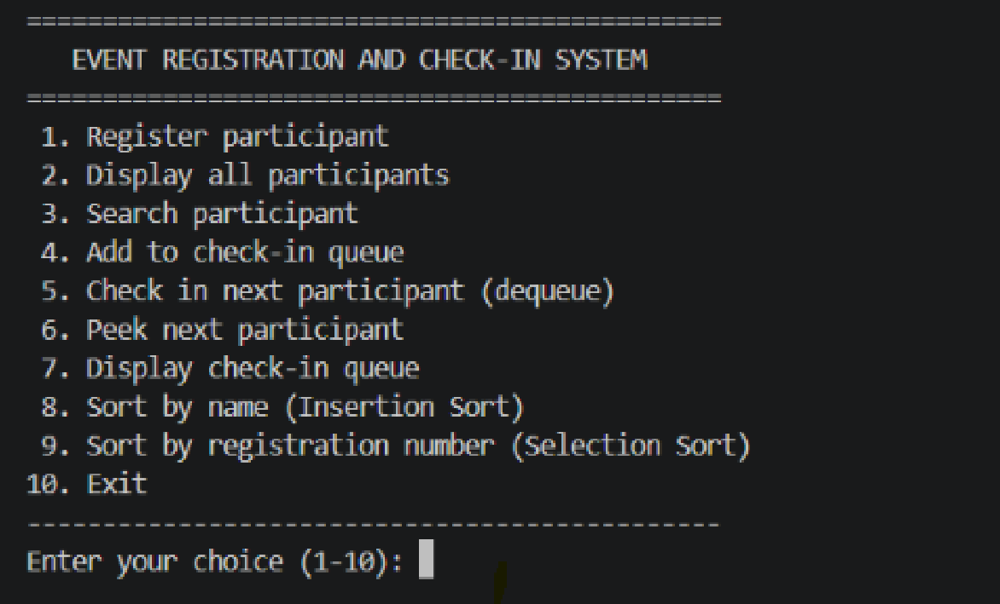
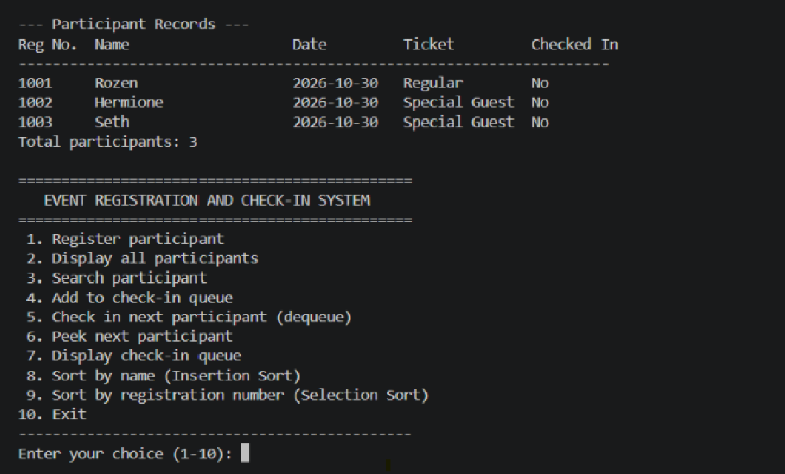
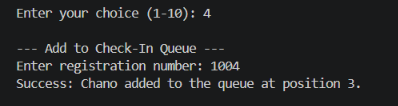
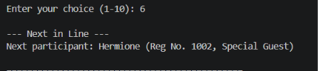
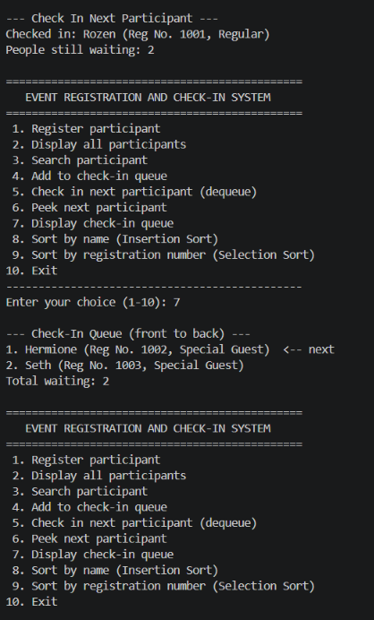
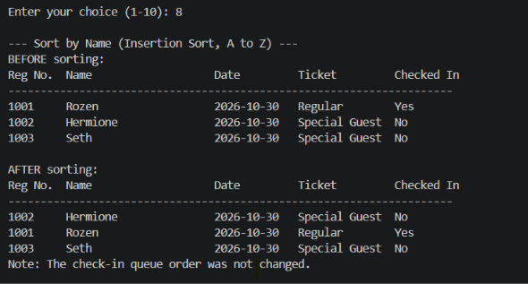
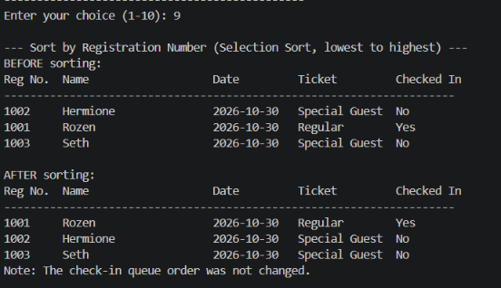
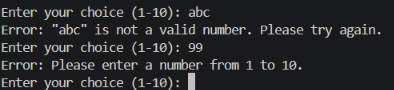

# Event Registration and Check-In System

## Project Description

This is a console-based Java application that manages participants of an event. Organizers often register many people and then have to check them in at the entrance, one at a time, in the order they arrive. Doing this on paper is slow and error-prone.

This system lets the organizer register participants, search and view their records, sort the records, and place participants in a check-in line. Participants are then checked in following the **First-In, First-Out (FIFO)** principle, so the person who joined the line first is always served first.

The program is written in **procedural Java**. It uses only the `Main` class with static methods. It has no custom classes and no OOP.

## Objectives

- Store participant records using Java `ArrayList`s.
- Implement **Insertion Sort** and **Selection Sort** manually, without built-in sorting methods.
- Manage the check-in line using a `Queue` (FIFO).
- Provide a menu-driven console interface.
- Validate user input so the program does not crash on invalid entries.
- Show clear messages for empty lists, empty queues, and missing records.

## Use Cases and Features

| Menu | Feature | Description |
|------|---------|-------------|
| 1 | Register participant | Saves name, registration date, and ticket type. A registration number is assigned automatically, starting at 1001. |
| 2 | Display all participants | Shows all records in a table, including whether each participant has checked in. |
| 3 | Search participant | Search by registration number or by name (full or partial). |
| 4 | Add to check-in queue | Enqueues a participant using their registration number. |
| 5 | Check in next participant | Dequeues the first person in line and marks them as checked in. |
| 6 | Peek next participant | Shows who is next without removing them from the queue. |
| 7 | Display check-in queue | Shows the line from front to back. |
| 8 | Sort by name | Insertion Sort, A to Z. |
| 9 | Sort by registration number | Selection Sort, lowest to highest. |
| 10 | Exit | Ends the program. |

## Data Structure Explanation

### ArrayLists (records)

Participant records are stored in five parallel `ArrayList`s. The data at index `i` in each list belongs to the same participant.

| ArrayList | Data |
|-----------|------|
| `names` | Participant name |
| `regNumbers` | Registration number |
| `regDates` | Registration date |
| `ticketTypes` | Regular or Special Guest |
| `checkedIn` | `true` if already checked in |

When a participant is registered, a value is added to all five lists together. When the records are sorted, the `swapAll()` method swaps all five lists at the same time, so the data always stays synchronized.

### Queue (check-in line)

The check-in line is a `Queue<Integer>` implemented with a `LinkedList`. It stores **registration numbers**, not list positions, so sorting the records never changes the order of the line.

| Operation | Method used | Menu |
|-----------|-------------|------|
| Enqueue | `add()` | 4 |
| Dequeue | `poll()` | 5 |
| Peek | `peek()` | 6 |
| Display | loop through the queue | 7 |
| Empty check | `isEmpty()` | used in 5, 6, 7 |

## Sorting Algorithm Explanation

### 1. Insertion Sort (by name)

Insertion Sort goes through the records one at a time and slides each record to the left until it is in its correct alphabetical position. It is suitable here because the number of participants is small, and it works well on lists that are already partly in order, such as when new people are added one at a time. It is used so the organizer can find people quickly in an A to Z list.

### 2. Selection Sort (by registration number)

Selection Sort repeatedly finds the smallest registration number in the unsorted part of the list and swaps it into the next position. It is simple and easy to follow, and it makes few swaps. It is used to bring the records back to the order in which people registered.

Both algorithms are written by hand. `Collections.sort()` and `Arrays.sort()` are not used.

## How to Run the Program

**Requirements:** Java Development Kit (JDK) 17 or newer.

1. Download or clone this repository.
2. Open a terminal in the project folder.
3. Compile:
   ```
   javac src/Main.java
   ```
4. Run:
   ```
   java -cp src Main
   ```

You can also open the project in VS Code with the Extension Pack for Java and click **Run** above the `main` method.

## Screenshots of the System

### Main menu


The main menu with all ten options.

### Adding records and displaying stored records


Three participants are registered and shown in the records table.

### Queue operation: enqueue


A participant is added to the check-in queue.

### Queue operation: peek


The next participant in line is shown without being removed.

### FIFO behavior (dequeue and display queue)


The first participant added to the queue (Rozen) is checked in first. After that, the next participant in line (Hermione) moves to the front, which shows First-In, First-Out.

### Sorting algorithm 1: Insertion Sort (by name)


Records before and after sorting by name, A to Z. The queue order is not changed.

### Sorting algorithm 2: Selection Sort (by registration number)


Records before and after sorting by registration number, lowest to highest.

### Input validation and error messages


Invalid menu inputs (`abc` and `99`) show error messages and the program asks again.
